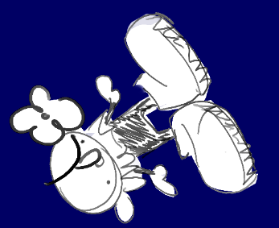
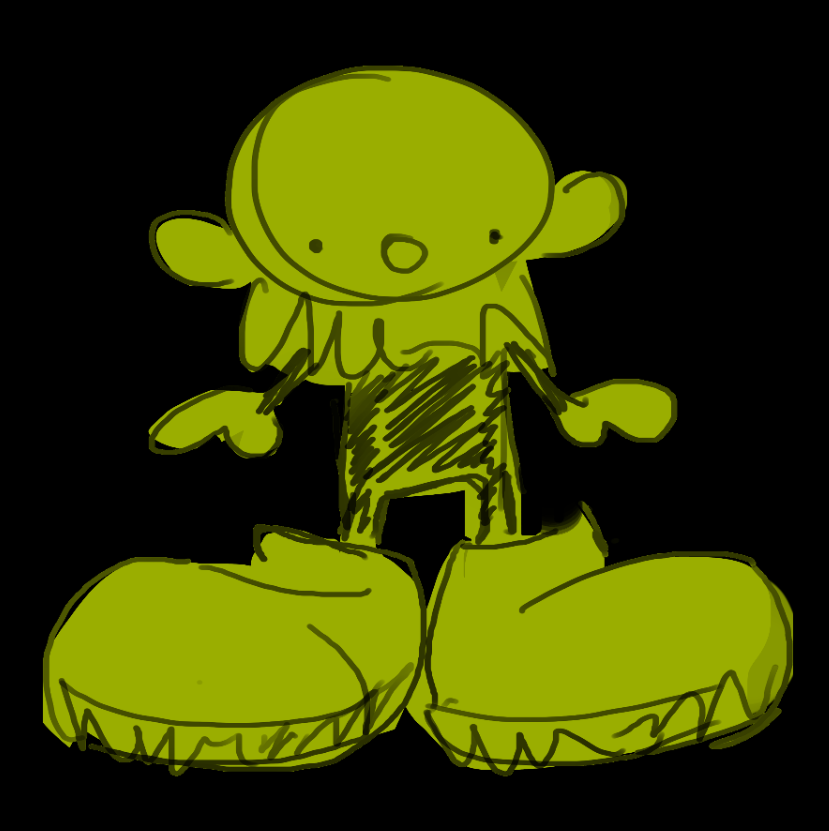

# Week 5

[back to ReadME](../README.md)  
idk if you want to go back, thats a lot of reading...  
 
 ## 13/10/26, 4:50pm, repeatedly in laval
 
 
for this weeks assignment, we were asked to experiment with events.  

When starting projects, i like to look at the p5 reference library. I know we already looked at java script events in class, but to keep things simple for myself, i thought i should just take a look! I'm really surprised by the amount of "mobile centered" events: deciveORientation, deviceShaken, and deviceTurned for example. I dont plan on using them, since testing it out kinda sounds like a nightmare, but it opens the door to using a phone as a controller. This is something i've experimented a little bit [before](https://sites.google.com/view/anannanangygygygygy/prototype-3?authuser=0).   

my head was very empty at the start of this assignment. each time i would see an event that would interest me, i would start thinking of variables that could be cool to experiment with and not the actual event. for example, fullscreen, knowing the dimension of the screen colour be really cool, you could have a character try to match itself to the dimensions of the screen. i drew a silly clown with a flower and looked for ways to include them in all three prototypes.  

in my first prototype, i used mouseDragged() and mouseReleased() to create game when hugo (the clown) gives you a flower if you pet him. the flower colour changes based on how much you love hugo and hugo shakes to give a visual indication of the petting. i should probably start using constants instead of setting everything to a variable. i dont think it would do anything performance wise, but its probably just a good pratice to intergrate.
[online project](https://angycyr.github.io/manilovecart253/topics/eventPrototype/prototype1/index.html) 
[js](https://github.com/angycyr/manilovecart253/blob/main/topics/eventPrototype/prototype1/js/script.js) 
  

since in my first prototype, i mainly used mouse commands and stuff within the p5 library, i wanted to use the keyboard in the second prototype. the most commonly used key i can think of were wasd, so thats what i ended up using for it with keydown and event.key. to add more spice, instead of having 'w' and 's' go forward and backwards, i used them to make hugo flip with rotate(). after 5 flips, hugo gives you a flower. coding for this one was a lot smoother than the previous one. i think i can award that to it being pretty straight foward and the only new piece of information being able to use full javascript as a the trigger.  
[online project](https://angycyr.github.io/manilovecart253/topics/eventPrototype/prototype2/index.html) 
[js](https://github.com/angycyr/manilovecart253/blob/main/topics/eventPrototype/prototype2/js/script.js) 
 

unlike the transition between prototype 1 and 2, there wasnt really a sensical progression fron here. so i just decided to do something simpler. i used mouseMoved() to check wether the mouse was hovering an image (this was actually not simple at all, i had to take 2 breaks) and shifting colours to add a bit of an accent with map() using mouse coords and speed 
[online project](https://angycyr.github.io/manilovecart253/topics/eventPrototype/prototype3/index.html) 
[js](https://github.com/angycyr/manilovecart253/blob/main/topics/eventPrototype/prototype3/js/script.js) 

