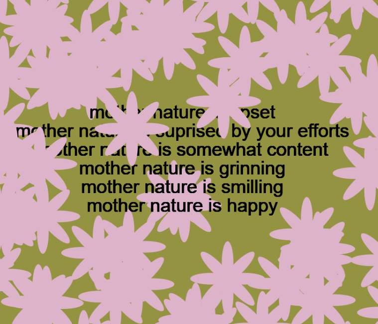
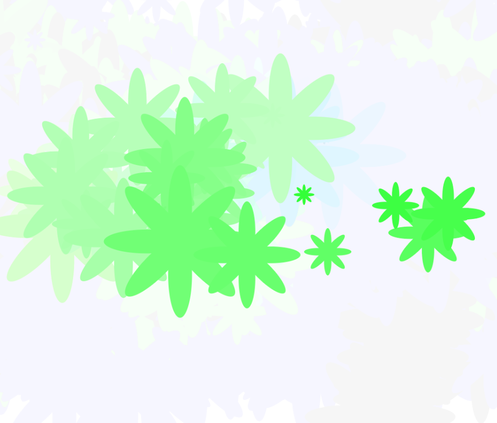
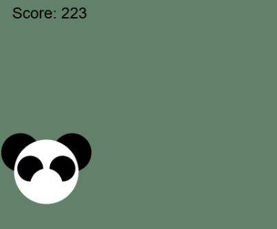

# Week 6

[back to ReadME](../README.md)  
idk if you want to go back, thats a lot of reading...  
 
 ## 27/10/26, 9:50am, with and without a doubt in laval
 

 last week, i saw in erica's project, you could use window width and height as variables. so i wanted to try it this time. i always found the blank sides kinda too blank but also felt far too lazy to go change it in the index.html file, so i made my peace with it. no longer does peace have to be the default option! violence !! i mean not really, but still! its very cool stuff. i do worry that since its full screen, there isnt any space to put extra info if its ever needed. like gameplay instructions and whatnot.
[online project](https://angycyr.github.io/manilovecart253/topics/functionPrototype/prototype1/index.html) 
[js](https://github.com/angycyr/manilovecart253/blob/main/topics/functionPrototype/prototype1/js/script.js) 
  

i think they're called classes? last week in hue hugo, i tried to use mouseX, mouseY, and mouse speed to generate me different colours to colour hugo. i found using the regular RGB to very quickly muddy the colours? speed doesnt really give an equal oppertunity compared to mouseX and mouseY. using colormode() and changing it to HSB resolves this issue!  
since in the prototype 1, i only used the function parameters for variables, i decided to use them with the class ( is it technically a class?) this time. i also decided to try bringing the variable into a function of its own to not need to bother with redefining outside of the setup.
 
[online project](https://angycyr.github.io/manilovecart253/topics/functionPrototype/prototype2/index.html) 
[js](https://github.com/angycyr/manilovecart253/blob/main/topics/functionPrototype/prototype2/js/script.js) 
 

in this point of the prototyping. im kinda spent... i dont really know of other function specific behaviours to explore. so, we're going simple... really simple. back to the panda !!!  
[online project](https://angycyr.github.io/manilovecart253/topics/functionPrototype/prototype3/index.html) 
[js](https://github.com/angycyr/manilovecart253/blob/main/topics/functionPrototype/prototype3/js/script.js) 

